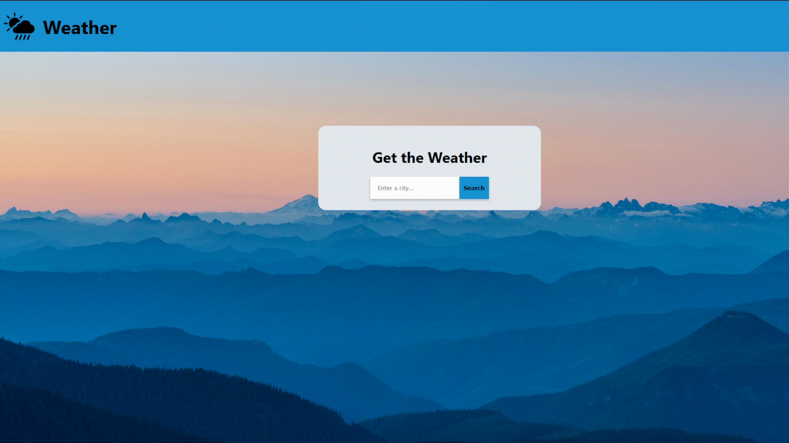

# Project: Weather App | The Odin Project
 
O objetivo deste projeto foi desenvolver uma aplicação de previsão meteorológica utilizando JavaScript, HTML e CSS, com o apoio do Webpack e integração com a Visual Crossing Weather API.

A aplicação permite ao utilizador pesquisar diferentes cidades e consultar as condições meteorológicas atuais, incluindo temperatura, sensação térmica, humidade, velocidade do vento e nebulosidade, bem como a previsão meteorológica para os próximos dias. Também apresenta informações sobre a localização e a data, acompanhadas por ícones que representam as condições meteorológicas.

Este projeto faz parte do percurso JavaScript do The Odin Project e teve como principal objetivo consolidar os conhecimentos adquiridos em JavaScript, especialmente na utilização de APIs, programação assíncrona e manipulação dinâmica da interface.

Durante o desenvolvimento, foram aplicados conceitos como manipulação do DOM, módulos JavaScript, importação e exportação de funções, event listeners, Promises, async/await, consumo de APIs externas, processamento de dados JSON, tratamento de erros, criação de classes e objetos, animações CSS e utilização do Webpack.

## Podes visualizar o projeto aqui:
https://rafaelribeiro2003.github.io/Project-Weather-App-theodinproject/

## Screenshot:

## Créditos: 
Este projeto foi desenvolvido como parte do currículo do **The Odin Project**.

---
## 🇬🇧 English

The goal of this project was to develop a weather forecast application using JavaScript, HTML, and CSS, with the help of Webpack and integration with the Visual Crossing Weather API.

The application allows users to search for different cities and check current weather conditions, including temperature, feels-like temperature, humidity, wind speed, and cloudiness, as well as the weather forecast for the upcoming days. It also displays location and date information, accompanied by icons representing the weather conditions.

This project is part of The Odin Project's JavaScript curriculum and its main objective was to consolidate the JavaScript knowledge acquired throughout the course, particularly in API integration, asynchronous programming, and dynamic interface manipulation.

During development, concepts such as DOM manipulation, JavaScript modules, importing and exporting functions, event listeners, Promises, async/await, external API integration, JSON data processing, error handling, classes and objects, CSS animations, and the use of Webpack were applied.

## Live Demo
https://rafaelribeiro2003.github.io/Project-Weather-App-theodinproject/

## Screenshot

## Credits
This project was completed as part of **The Odin Project** curriculum.
